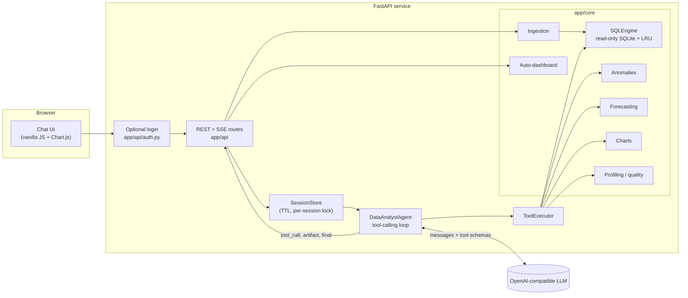

# DataPilot — AI-Powered Data Analyst

Upload one or more CSV files and ask questions in plain English. DataPilot answers from the data, draws charts, writes SQL, flags anomalies, and shows the query behind every number. You can inspect that SQL, edit it, and run it again.

Built for the Digital Back Office *AI Engineer / Software Engineer Intern* assignment.

**Stack:** Python · FastAPI · pandas · SQLite · any OpenAI-compatible LLM (Gemini, Groq, OpenAI, Claude, or Ollama) · vanilla JS and Chart.js

**Architecture:** [interactive diagram](docs/architecture/datapilot.html) · [source specification](.archify/architecture-datapilot-20261106-120000/candidate.json)

Run it locally with the steps below, load the sample data, and ask a question. Chat needs an API key. Uploads, the dashboard, data-quality checks, and the SQL editor work without one.

---

## Requirements checklist

| Assignment requirement | How it is met | Where |
|---|---|---|
| Upload and validate one or more CSVs | Multi-file upload and drag-and-drop. Checks extension, size, emptiness, binary content, encoding (UTF-8, Windows-1252, Latin-1), delimiter (comma, semicolon, pipe, tab), malformed rows, and row/column limits. Cleans column names, infers numbers (`$1,200`), dates, and booleans, and keeps IDs such as `007` as text. Every change is reported to the user. | `app/core/ingestion.py` |
| Answer questions in natural language | An LLM agent with tool calling plans a query, runs it, reads the result, fixes its own SQL errors, and then answers. | `app/agent/` |
| Business insights and summaries | The system prompt requires a direct answer, insights, a **How I got this** section, caveats when they matter, and follow-up questions. | `app/llm/prompts.py` |
| Charts (bar, line, pie, scatter, and others) | The `create_chart` tool supports bar, horizontal bar, line, area, pie, doughnut, and scatter. | `app/core/charts.py` |
| Generate SQL and/or Pandas | Every query the agent runs is shown in the UI, where it can be copied, edited, and re-run. Pandas code is returned when the user asks for it. | `static/app.js`, prompt rule 9 |
| Detect anomalies and explain why | IQR, z-score, and MAD detection, optionally inside each group. Each finding includes the rule, expected range, severity, and a plain-English reason. | `app/core/anomalies.py` |
| Explain the reasoning | The answer includes **How I got this**. The UI also shows a collapsible reasoning trace: every tool call, its outcome, and its timing. | `app/agent/agent.py`, `static/app.js` |
| Keep conversation context | Recent turns, including the SQL already used, are sent back to the model, so a follow-up such as “and for 2025?” still works. | `app/core/session.py` |

**Also included:** joins across uploaded files, an automatic dashboard, data-quality scores from 0 to 100, a transparent forecast, an agent tool loop, an LRU cache on identical SQL, a Markdown report export, Server-Sent Events for live progress, structured logs, an evaluation harness, Docker, a Render blueprint, GitHub Actions, and an optional demo login for public hosting.

---

## Architecture

The interactive diagram is the view meant for reviewers. The diagram below is the same flow in a form GitHub can render.



**What happens when you ask a question**

1. The browser posts to `POST /api/sessions/{id}/chat/stream` and reads Server-Sent Events.
2. The agent builds one prompt: system rules, the live schema of every loaded table (types, ranges, and exact category values), and recent history.
3. The model either answers or calls tools: `run_sql`, `create_chart`, `detect_anomalies`, `data_quality_report`, `forecast`, and `describe_table`.
4. The executor runs those tools on the in-memory tables. Compact results go back to the model. Rich artifacts (tables, charts, anomaly reports, forecasts) stream to the UI as soon as they are ready.
5. A bad query or an unknown column comes back as a tool error, so the model can correct itself. The loop stops at `MAX_AGENT_STEPS` (default **2**). A final call with tools turned off forces a written answer from the evidence already collected.
6. The answer, follow-up questions, reasoning trace, and token usage are stored on the session and sent to the UI.

Login is off unless `AUTH_ENABLED=true`. When it is on, only `/login`, `/signup`, `/logout`, and `/api/health` are public. Everything else requires the `dp_auth` cookie.

---

## Quick start

### Local (Python 3.10+)

```bash
git clone https://github.com/anshswarn15/ai-analyst.git
cd ai-analyst
python -m venv .venv && source .venv/bin/activate      # Windows: .venv\Scripts\activate
pip install -r requirements-dev.txt

cp .env.example .env        # add one API key (Gemini and Groq have free tiers)
uvicorn app.main:app --reload
```

Open [http://localhost:8000](http://localhost:8000), click **Load sample data**, and ask a question. Login is off in this setup.

### Docker

```bash
cp .env.example .env        # add one API key
docker compose up --build   # http://localhost:8000
```

Compose forwards the LLM settings from `.env`. It does not turn login on. The image runs a single Uvicorn worker because analysis sessions live in process memory.

### Public demo on Render

[`render.yaml`](render.yaml) deploys the Docker image as a web service. Push the repository, then create a Render **Blueprint** from it. Set these secrets in the Render dashboard. Do not commit them.

```text
GROQ_API_KEY=<your Groq key>
APP_USERNAME=demo-admin
APP_PASSWORD=<a long random password>
```

The blueprint sets `LLM_PROVIDER=groq`, `LLM_MODEL=openai/gpt-oss-20b`, `AUTH_ENABLED=true`, `ALLOW_SIGNUP=false`, and `AUTH_COOKIE_SECURE=true`. It generates `SESSION_SECRET`. Render probes `/api/health`. The rest of the app requires a signed-in account.

`APP_USERNAME` and `APP_PASSWORD` create the first admin in a local SQLite file (`data/auth.db`). Public sign-up stays off so strangers cannot create accounts and spend the LLM budget. Turn `ALLOW_SIGNUP` on only for a private demo. This login is a demo gate: signed cookie, scrypt password hashes, and a 12-hour session. It is not a substitute for OAuth, password reset, verified email, rate limits, or durable multi-user storage. On Render’s default disk the account database is lost when the service is redeployed unless `AUTH_DB_PATH` points at persistent storage.

### Choosing an LLM

Set `LLM_PROVIDER` to `gemini`, `groq`, `openai`, `anthropic`, or `ollama`, and set the matching `*_API_KEY` in `.env`. For another OpenAI-compatible endpoint, set `LLM_API_KEY`, `LLM_BASE_URL`, and `LLM_MODEL`. All of them go through one tool-calling client in `app/llm/client.py`. Override `LLM_MODEL` when a provider retires the default name. Ollama needs no real key. With no key configured, the app still starts and the UI says that chat needs one.

| Provider | Default model | Key variable |
|---|---|---|
| `gemini` | `gemini-2.5-flash` | `GEMINI_API_KEY` |
| `groq` | `openai/gpt-oss-20b` | `GROQ_API_KEY` |
| `openai` | `gpt-4o-mini` | `OPENAI_API_KEY` |
| `anthropic` | `claude-sonnet-4-6` | `ANTHROPIC_API_KEY` |
| `ollama` | `llama3.1` at `http://localhost:11434/v1` | none |

---

## Try these

Sample files in `data/sample/` — `sales.csv` (about 2,400 order lines), `customers.csv`, and `products.csv` — come from `scripts/generate_sample_data.py`. The generator plants problems on purpose: absurd quantities, a typo-sized revenue, a negative revenue, duplicate rows, missing regions, `north ` / `NORTH` spellings, and three products nobody buys.

- *Which region generated the highest revenue?*
- *Show monthly sales trends.* Then: *forecast the next 6 months.*
- *Which products are underperforming?*
- *What are the top five customers?* Then: *which country are they from?*
- *Generate SQL for this analysis.* / *Give me the pandas version.*
- *Detect anomalies in the dataset.* Then: *are any of those just data-entry errors?*
- *How clean is this data?*

The app has three views: **Ask data**, **Dashboard**, and **Data quality**. **Export report (.md)** downloads the conversation, the SQL, and the artifacts.

---

## Design decisions

| Decision | Why | Trade-off |
|---|---|---|
| The LLM writes SQL. A tool runs it. | Numbers are computed, not guessed. Every answer can be audited, and the CSV does not have to fit in the context window. | The prompt must carry column types, ranges, and exact category values so filters match the data. |
| In-memory SQLite | No extra database for analysis, a lock makes it safe to share, and the engine is easy to test. `DATE_TRUNC`, `MEDIAN`, and `STDEV` are registered as functions. One class owns the engine, so DuckDB could replace it. | SQLite is missing some analytical functions. The prompt teaches the dialect the tools actually run. |
| Four checks on model-written SQL | A statement must be a single `SELECT` or `WITH`. A SQLite authorizer denies every non-read action. A progress handler stops a query after 10 seconds. Results are capped (default 500 rows). Identical SQL is cached (LRU, 128 entries). | These checks protect the database, not the host. Uploaded files are still untrusted input. |
| One OpenAI-compatible client | Gemini, Groq, OpenAI, Claude, and Ollama share one code path and one tool-calling format. | Provider-only features, such as Anthropic prompt caching, are unused. |
| Statistical anomaly detection | IQR, z-score, and MAD are deterministic and explainable. The model interprets the findings. It does not invent them. | IQR on skewed columns flags many large but legitimate values. Findings are ranked by severity, and the answer focuses on the top ones. |
| Analysis sessions stay in memory, one worker | No database is required to try the assignment, and a per-session lock stops two questions from running at once. Idle sessions expire after 120 minutes. | A restart drops uploaded data and chat history. More than one worker would not share that state. The next step is Redis or Postgres plus object storage. |
| Login is optional and separate from analysis sessions | Local review stays one command. A public Render deploy can require an account so the API key is not open to the internet. Accounts live in `data/auth.db`. | This is a demo login. It does not reset passwords, verify email, or rate-limit guesses. |
| Two tool steps by default | `MAX_AGENT_STEPS=2` keeps latency and token cost predictable. The prompt tells the model to plan the smallest complete set of calls and send them together. | A question that needs several retries can run out of steps. Raise `MAX_AGENT_STEPS` when you want a longer investigation. |
| Frontend with no build step | A reviewer can read `static/index.html`, `static/app.js`, and `static/style.css` directly. | It has fewer interface features than a React app. |

---

## Assumptions and limitations

- Uploaded tables live **in memory on one session** (defaults: 25 MB per file, 10 files, 1,000,000 rows per file) and are deleted after 120 minutes idle. They are not written to disk.
- Dates without a clear format are parsed month-first, so `03/04/2024` is 4 March. ISO dates are unambiguous.
- Words such as “underperforming” are not fixed metrics. The model must state the definition it used, for example the bottom quartile by revenue.
- Forecasting is a linear trend, plus seasonality when the series has at least two full cycles, with a rough 95% band. It is a baseline, not a full time-series model.
- Cell values are untrusted. The prompt tells the model to treat them as data. A prompt hidden in a cell cannot be ruled out completely. The tools it can call are read-only.
- Pandas shown in an answer is text from the model. The server does not execute it.
- The account screen is for a hosted demo. A production system needs OAuth or verified email, password reset, rate limiting, and durable user and session storage.

---

## API

Interactive docs: [http://localhost:8000/docs](http://localhost:8000/docs).

| Method and path | Purpose |
|---|---|
| `GET /api/health` | Status, provider, model, and whether a key is configured. Public even when login is on. |
| `GET /login`, `POST /login` | Sign-in form. Sets an HttpOnly `dp_auth` cookie for 12 hours. |
| `GET /signup`, `POST /signup` | Create an account. Only when `ALLOW_SIGNUP=true`. |
| `POST /logout` | Clears the cookie. |
| `POST /api/sessions` | Start a session. |
| `GET /api/sessions/{id}` | Tables, profiles, and turns. |
| `DELETE /api/sessions/{id}` | Delete the session. |
| `POST /api/sessions/{id}/files` | Upload one or many CSVs (`files`). Each file is accepted or rejected on its own. |
| `DELETE /api/sessions/{id}/files/{table}` | Remove one table. |
| `DELETE /api/sessions/{id}/files` | Remove every table and clear the chat. |
| `POST /api/sessions/{id}/load-samples` | Load the bundled sample CSVs. |
| `POST /api/sessions/{id}/chat` | Ask a question. JSON response. |
| `POST /api/sessions/{id}/chat/stream` | Same question as Server-Sent Events. |
| `POST /api/sessions/{id}/sql` | Run read-only SQL yourself. |
| `POST /api/sessions/{id}/reset-chat` | Clear the conversation and keep the tables. |
| `GET /api/sessions/{id}/dashboard` | Automatic dashboard. |
| `GET /api/sessions/{id}/quality` | Data-quality scores. |
| `GET /api/sessions/{id}/export.md` | Download the conversation as Markdown. |

A second question in the same session while the first is still running returns `409`.

---

## Testing and evaluation

```bash
pytest -q                    # unit and agent-loop tests; scripted fake LLM, no network, no key
python -m evals.run_evals    # six questions to the real model, checked against pandas
```

Tests cover ingestion edge cases, the SQL sandbox (writes, `PRAGMA`, and multi-statements), anomaly, forecast, and chart logic, the agent loop (a bad query that is corrected, context carried into the next turn, the step limit, an LLM failure, and the no-data short-circuit), and the HTTP API. CI runs `pytest` on Python 3.12 for every push and pull request (`.github/workflows/ci.yml`).

The eval harness needs a real API key and exits non-zero when an answer misses the pandas ground truth.

---

## Observability

Logs are structured `key=value` lines on stdout: request id and latency (the `X-Request-ID` response header), tool name, outcome, and latency, turn latency and token usage, upload accept or reject reasons, and LLM errors.

---

## Project layout

```
app/
  main.py            app factory, auth gate, request logging, error handlers
  config.py          environment settings and provider presets
  api/routes.py      analysis HTTP and SSE routes
  api/auth.py        sign-in and sign-up pages
  agent/agent.py     tool-calling loop, events, history
  agent/tools.py     tool schemas and executor
  llm/client.py      OpenAI-compatible client
  llm/prompts.py     system prompt
  core/              ingestion, sql_engine, profiling, anomalies, forecasting,
                     charts, dashboard, session, report, auth
static/              index.html, style.css, app.js
data/sample/         sample CSVs
scripts/             sample-data generator
tests/               pytest suite
evals/               live-model evaluation harness
docs/architecture/   interactive architecture diagram
render.yaml          Render Blueprint
```

---

## What is in this submission

- Application source, sample datasets, Dockerfile, Compose file, and Render blueprint
- Tests, the evaluation harness, and the GitHub Actions workflow
- Architecture diagram: [`docs/architecture/datapilot.html`](docs/architecture/datapilot.html)


